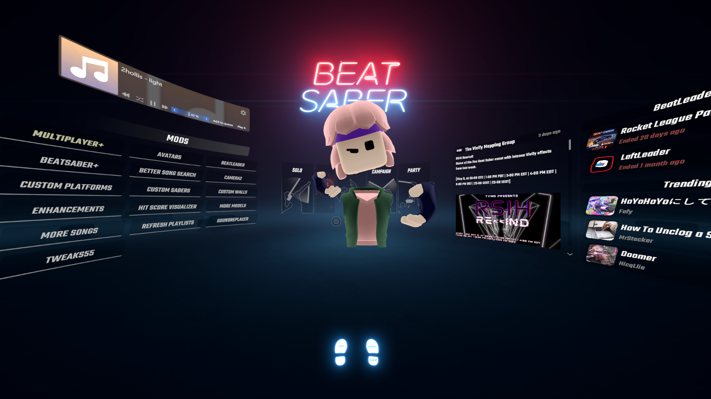

BetterBSAvatar is a PC Beat Saber mod that displays the game's built-in multiplayer avatar in menus and single-player gameplay.



## Features


- Creates and displays your built-in Beat Saber multiplayer avatar outside multiplayer lobbies.
- Tracks the avatar to your headset and hand/controller positions.
- Updates the avatar after changes are applied in Beat Saber's avatar editor.
- Saves named avatar appearances, with arrows to browse them in the native avatar editor.
- Includes a transparent window on the right of the native editor, with Saved Avatars above Display Settings.
- Provides an option to hide the avatar from the first-person headset view for normal play or third-person camera setups.
- Works with BeatLeader & ScoreSaber replays in FPFC mode!
- Can be used with Camera2! 

## Requirements And Platform

- Beat Saber 1.40.8 on PC.
- BSIPA 4.3.6 or a compatible 4.x version.
- BeatSaberMarkupLanguage 1.12.5 or a compatible 1.x version.
- Windows PCVR only.

Standalone Quest/Android builds are not supported.

## Installation

1. Install BSIPA and BeatSaberMarkupLanguage for Beat Saber 1.40.8.
2. Download the latest `BetterBSAvatar-vX.Y.Z.zip` release.
3. Extract the zip into your Beat Saber install folder so `BetterBSAvatar.dll` lands in `Plugins`.
4. Launch Beat Saber.
5. Open the main-menu gear, then `Avatar`.

## Saved Avatars

The **Saved Avatars** section at the top of the right-side BetterBSAvatar window includes the name row, previous/next arrows, and **Save**/**Delete** buttons. The native appearance editor retains its original layout. Naming and confirmation dialogs open centered on the main screen.

- **Save** stores the appearance currently shown in the editor. For a selected saved avatar, it stays gray until the appearance changes; Undo back to the saved appearance disables it again. Enter a new name to save a copy; using an existing name asks before overwriting it.
- The **arrows** cycle through saved appearances and the current-avatar draft. Loading a preset is an editable change, with native Undo/Redo support.
- Click a saved avatar's **name** to rename it. An asterisk means the editor appearance differs from that saved entry.
- **Delete** asks before removing a saved entry and leaves the editor appearance unchanged.
- Use the game's **Apply** or **Create Avatar** button to make an appearance your active game avatar. **Cancel** restores the previously applied appearance. Explicit preset saves and deletes remain saved when you cancel editing.

Presets contain appearance only and are stored in `UserData/BetterBSAvatar/Avatars` within the game installation. Each preset has a separate JSON file; overwrites and renames retain the previous file as a `.json.bak` backup. Backups are not loaded automatically. Unreadable or incompatible files are left unchanged.

## Settings

The transparent BetterBSAvatar window appears on the **right side** of the native Avatar editor, with a blue title header and **Display Settings** below **Saved Avatars**. Settings preview immediately as you toggle them. Use the main avatar window's **Apply** (or **Create Avatar**) to keep them, or **Cancel** to restore the previously applied settings. Previewing does not write settings to disk. Leaving the editor without Apply also restores the previous settings.

Both sections share a standard BSML scrollbar with Page Up/Down arrows. The blue title header stays fixed while the content scrolls.

- `Enable Avatar`: creates, displays, tracks, and refreshes the avatar.
- `Show in First Person`: shows the avatar in the headset view. Disable this if you only want the avatar visible to third-person camera setups.

## Building

Build with a .NET SDK and the .NET Framework 4.7.2 reference assemblies available. The project also recognizes the locally cached `Microsoft.NETFramework.ReferenceAssemblies.net472` 1.0.3 package. Set `GameDir` or `BEAT_SABER_DIR` to a modded Beat Saber 1.40.8 reference installation; building does not install the plugin unless `CopyToGame=true` is supplied.

```powershell
dotnet build BetterBSAvatar.csproj -c Release -p:GameDir="C:\path\to\Beat Saber" -p:UseSharedCompilation=false
```

## Patch Notes

See [PATCH_NOTES.md](PATCH_NOTES.md).

## License

BetterBSAvatar is licensed under the MIT License. See `LICENSE` for details.
